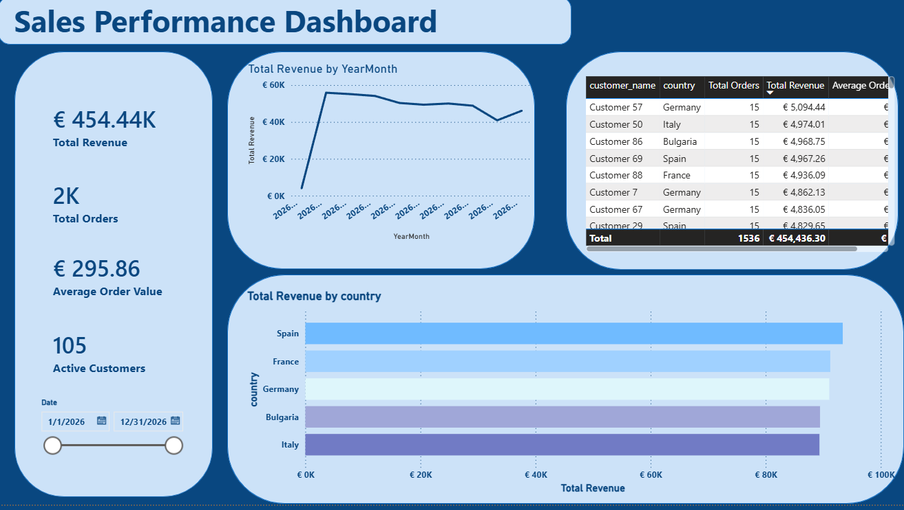
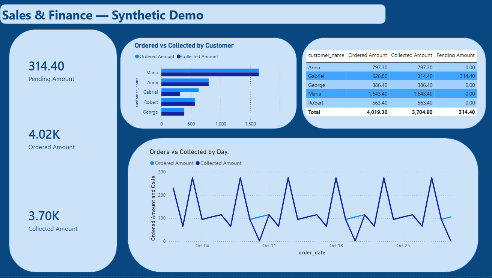
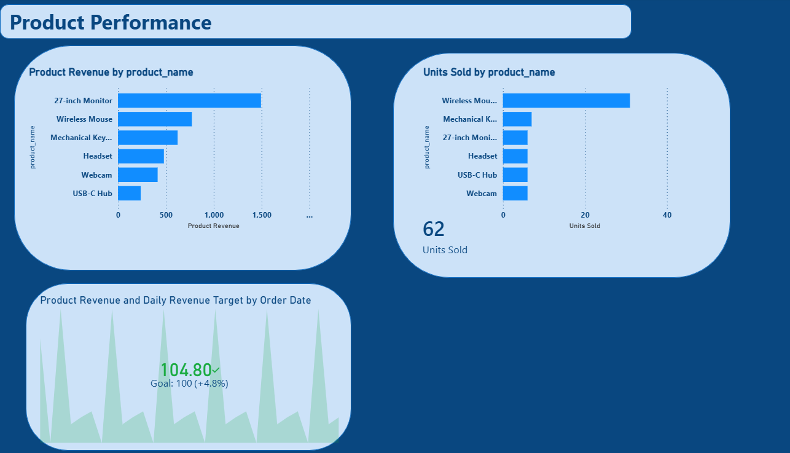

# Sales & Finance Reporting | Project CV

A portfolio project using PostgreSQL and Power BI to analyze orders, products,
customers, and payment status. The public SQL package creates a reproducible
**synthetic demo**; it does not contain the larger legacy practice dataset.

## What it demonstrates

- Relational modeling with primary keys, foreign keys, and validation checks.
- SQL joins, common table expressions, conditional aggregation, and window functions.
- Order-to-item and order-to-payment reconciliation.
- A PostgreSQL reporting view designed for Power BI.
- Power BI pages for sales and finance, and product performance.

## Run the SQL

Create a **new, empty PostgreSQL database** and run these files in order:

1. `01_schema.sql` — tables, relationships, and reporting view.
2. `02_demo_data.sql` — six products, five customers, 31 synthetic orders,
   62 order items, and 31 payments.
3. `03_analysis.sql` — four read-only analyses and quality checks.

For example, in DBeaver: connect to the new database, open each file in a SQL
editor, and execute the whole script. Do not run the first two scripts against
an existing database with tables of the same names.

The example orders cover **1–30 October 2026**. Some dates may be in the future
relative to when this project is viewed; they are generated example dates.

## Demo results

| Metric | Value |
| --- | ---: |
| Orders | 31 |
| Ordered value | 4,019.30 |
| Completed payments | 3,704.90 |
| Pending payments | 314.40 |
| Item-total mismatches | 0 |

The six product groups total 62 units. `unit_price` on `order_items` records
the price at purchase; `current_price` on `products` is the current catalog
price. Revenue queries use `unit_price`.

## Dashboard previews

### Sales performance — full practice dataset

This first page uses the working database's larger practice dataset. Its
1,536 dated orders shown in the selected range and approximately 454K revenue
cannot be reproduced from the 31-order public seed alone. The older orders do
not have item or payment detail and are excluded from product and finance KPIs.

### Sales and finance

### Product performance

The product KPI shows the last day's revenue (104.80) against an illustrative
daily target of 100. The generated daily pattern is deliberately repetitive;
it is a feature demonstration, not a forecast or business trend.

## Reporting model

`customers` → `orders` → `order_items` ← `products`; `payments` also links
to `orders`. The `project_cv_order_summary` view aggregates items and payments
separately, then joins the totals to each order. This prevents payment and item
rows from multiplying each other. An order with no payment record has a NULL
collected total, rather than being labeled unpaid.

The Power BI report was built separately: **Sales Performance**,
**Sales & Finance — Synthetic Demo**, and **Product Performance**.
A calendar table is created in
Power BI, so it does not appear in the PostgreSQL schema. Apply a page filter
for `data_origin = demo_generated` when connecting a report to the original
practice database. The `.pbix` report and screenshots can be added once they
have been exported and checked for connection details.

## Data scope

The working database also includes 1,506 older practice orders without item
or payment details. They are excluded from this public package. The seed file
recreates the checked demo totals and customer revenue; the payment method
may differ from the working database. No server address,
account name, or password is required in this repository.
